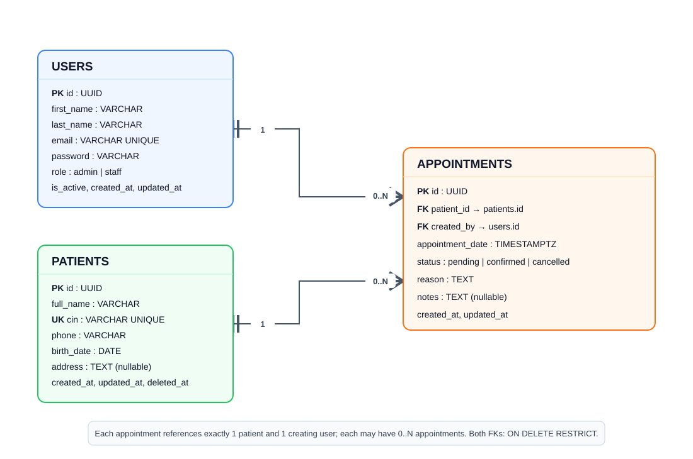

# ClinicFlow database design

The PostgreSQL schema is maintained in
[`backend/src/config/schema.sql`](./backend/src/config/schema.sql). It defines
the three required entities: users, patients, and appointments.

## Entity relationship diagram

Editable Draw.io source: [`docs/clinicflow-erd.drawio`](./docs/clinicflow-erd.drawio).
Open the `.drawio` file in VS Code with the Draw.io extension to view or edit it.

## Relationships and delete rules

- **User to appointments: one-to-many.** `appointments.created_by` references
  the user who created the appointment. `ON DELETE RESTRICT` prevents deleting
  a user while appointment records still refer to that user, preserving
  attribution and history.
- **Patient to appointments: one-to-many.** `appointments.patient_id` identifies
  the patient for each appointment. `ON DELETE RESTRICT` prevents physical
  deletion of a patient with appointment history. Patient removal is represented
  by the optional `patients.deleted_at` soft-delete field.
- There is no many-to-many relationship in this model; each appointment belongs
  to one patient and is attributed to one user.

## Constraints and indexes

- Each table uses a UUID primary key with `gen_random_uuid()` as its default.
- `patients.cin` is `UNIQUE` and required. `users.email` is also `UNIQUE`.
- Foreign keys from appointments to patients and users are required and use
  `ON DELETE RESTRICT` to preserve referenced clinical and audit history.
- `users.role` is restricted to `admin` or `staff`; appointment status is
  restricted to `pending`, `confirmed`, or `cancelled`.
- Indexes cover patient name and CIN search, soft-delete filtering, user email
  lookup, and appointment patient, date, status, and creator lookups.

## Sample data

[`backend/seed.js`](./backend/seed.js) creates one admin, two staff users, five
patients, and ten appointments with mixed statuses. The seed clears existing
appointment, patient, and user rows before inserting sample data; see the root
[README](./README.md) warning before running it.
